<picture>
  <source media="(prefers-color-scheme: dark)" srcset="./assets/banner-dark.svg">
  
</picture>

I'm Lenny, a Computer Science student at the Catholic University of Eastern Africa and a freelance full-stack developer in Nairobi. I design and build web products end to end, from the Figma file to the deployed app, and I'm working toward machine learning engineering.

**[Portfolio](https://lennydev.vercel.app)** · [LinkedIn](https://www.linkedin.com/in/lenny-kidavi-4693ba355) · [Email](mailto:lennykidavik@gmail.com) · [Fiverr](https://www.fiverr.com/lennynavwani) · [X](https://x.com/Lenny_kidavi)

<!--
  NOW: the only section meant to change often.
  Edit the three lines and the date. One short line each, three lines max.
-->
## Now

Updated 18 Oct 2026

- **Building** — a full visual redesign of [Saka](https://sakahapa.vercel.app), a local services marketplace for Nairobi
- **Studying** — probability and statistics, and AI fundamentals, as groundwork for ML
- **Open to** — freelance projects and internships

## Selected work

<!--
  To add a project: copy one row. Keep "What it is" under ~15 words.
  Order = most impressive first. Max 6 rows; move older ones to "Also".
-->

| Project | What it is | Built with | Links |
| :-- | :-- | :-- | :-- |
| **SmartChama** | Savings and loan platform for Kenyan chama groups, with a smart-contract layer. Hackathon winner. | Next.js · TypeScript · Firebase · Solidity | [Live](https://smartchama.tech) · [Code](https://github.com/chillyreward/SmartChama) |
| **Saka** | Inquiry-first marketplace connecting Nairobi households with local professionals. Direct M-Pesa, no commission. I lead product. | Next.js 14 · Supabase · Google Maps · Cloudinary | [Live](https://sakahapa.vercel.app) · Private repo |
| **Gikuyu Translator** | AI translation from English and Kiswahili into Gikuyu, with spoken output. | Next.js · Gemini API · ElevenLabs API | [Live](https://gikuyu-translate.vercel.app) · [Code](https://github.com/chillyreward/New-translator) |
| **NeuroGrowth** | Website upgrade for a Nairobi AI engineering studio. | Next.js · TypeScript · Tailwind CSS | [Code](https://github.com/Neuro-growth/neurogrowthwebsite) |
| **This portfolio** | My site and its design system, built from an original Arrakis-inspired identity. | Next.js 14 · TypeScript · Tailwind CSS | [Live](https://lennydev.vercel.app) · [Code](https://github.com/chillyreward/DunePortfolio) |

Also: client sites for [Oppolia Woodworths Kenya](https://oppoliakenya.co.ke) and [Sucre Bushworks](https://sucre-bushworks.vercel.app).

## Recognition

<!-- Newest first. Format: Result — Event, organiser · Month Year · Project -->

- **1st place** — Red, White & Build Hackathon, U.S. Embassy Kenya · Feb 2026 · SmartChama, with Rachael, Shilla and Nanjoli
- **2nd place** — Beorchild Hackathon (online) · 2026 · SmartChama

## Toolkit

**Ship with** &nbsp; TypeScript · Next.js · React · Tailwind CSS · Supabase · PostgreSQL · Zustand · TanStack Query · Vercel · Figma 
**Also used** &nbsp; Solidity · Firebase · Python · Java · C · Docker · Git 
**Learning** &nbsp; PyTorch · statistics and probability for ML

## Recent activity

<!--
  Filled in automatically every day by .github/workflows/activity.yml.
  Do not edit between the two markers; the workflow overwrites it.
-->
<!--START_SECTION:activity-->
<!--END_SECTION:activity-->

 

<picture>
  <source media="(prefers-color-scheme: dark)" srcset="./assets/ridge-dark.svg">
  
</picture>

<i>Fear is the mind-killer.</i> — Frank Herbert, <i>Dune</i>

