<picture>
  <source media="(prefers-color-scheme: dark)" srcset="./assets/banner-dark.svg">
  
</picture>

I'm Lenny, a Computer Science student at the Catholic University of Eastern Africa and a freelance full-stack developer in Nairobi. I design and build web products end to end, from the Figma file to the deployed app, and I'm working toward machine learning engineering.

**[Portfolio](https://lennydev.vercel.app)** · [LinkedIn](https://www.linkedin.com/in/lenny-kidavi-4693ba355) · [Email](mailto:lennykidavik@gmail.com) · [Fiverr](https://www.fiverr.com/lennynavwani) · [X](https://x.com/Lenny_kidavi) · [CV](https://lennydev.vercel.app/cv)

Jump to: [Now](#now) · [Selected work](#selected-work) · [Being built](#being-built) · [Recognition](#recognition) · [Toolkit](#toolkit) · [Across the sand](#across-the-sand)

<!--
  NOW: the only section meant to change often.
  Edit the lines and the date. One short line each, four lines max.
-->
## Now

Updated 2 Nov 2026

- **Building** — two client products, [Atrium and Planwright](#being-built), plus the Allenet Bakers website and rebrand
- **Launching** — [Saka](https://sakahapa.vercel.app), after a full redesign
- **Shipped** — [Dogear](https://dogear-nine.vercel.app), my Spotify companion app
- **Studying** — for December exams: AI, statistics, computer architecture and cloud computing

## Selected work

Click a picture to open the live site. Open <b>Case notes</b> for the story behind each one.

<!--
  Cards: two per row. Copy a <td> block to add one. Keep the one-line
  description under ~15 words; longer text goes inside 
.
  Thumbnails live in assets/work/ (1200x750, 16:10).
-->

<table>
<tr>
<td width="50%" valign="top">

<a href="https://smartchama.tech">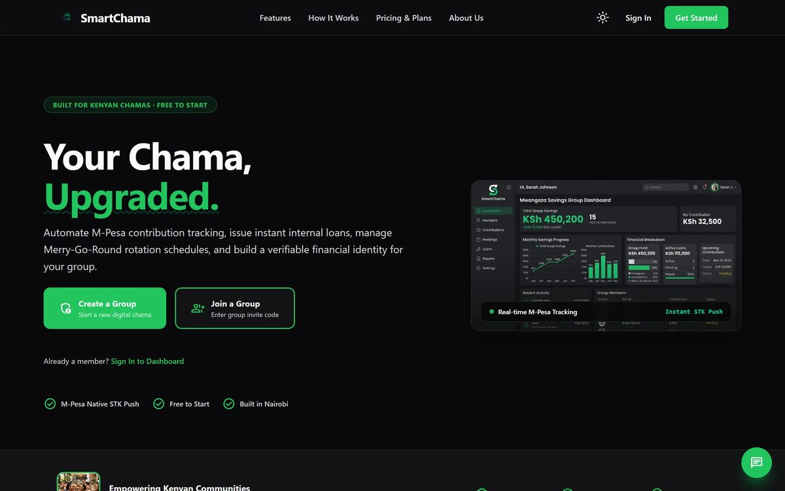</a>

### SmartChama
Product · 2026 · Hackathon winner

Savings and loan platform for Kenyan chama groups, with a smart-contract layer.

Next.js · TypeScript · Firebase · Solidity 
[Live](https://smartchama.tech) · [Code](https://github.com/chillyreward/SmartChama)

<b>Case notes</b>

 

Chamas run on trust, but most still track contributions, loans and Merry-Go-Round turns in notebooks and WhatsApp threads. My team and I built SmartChama to make that automatic and visible: M-Pesa contributions are tracked as they come in, loans and rotation schedules live in one place, and a Solidity smart-contract layer records the group's rules so no single person can quietly change them.

**Hardest part:** the M-Pesa integration. Members now pay with an STK push and see it in the group's records as it happens.

**Recognition:** 1st place at Red, White & Build (U.S. Embassy Kenya), 2nd at Beorchild. Built with Rachael, Shilla and Nanjoli.

</td>
<td width="50%" valign="top">

<a href="https://sakahapa.vercel.app">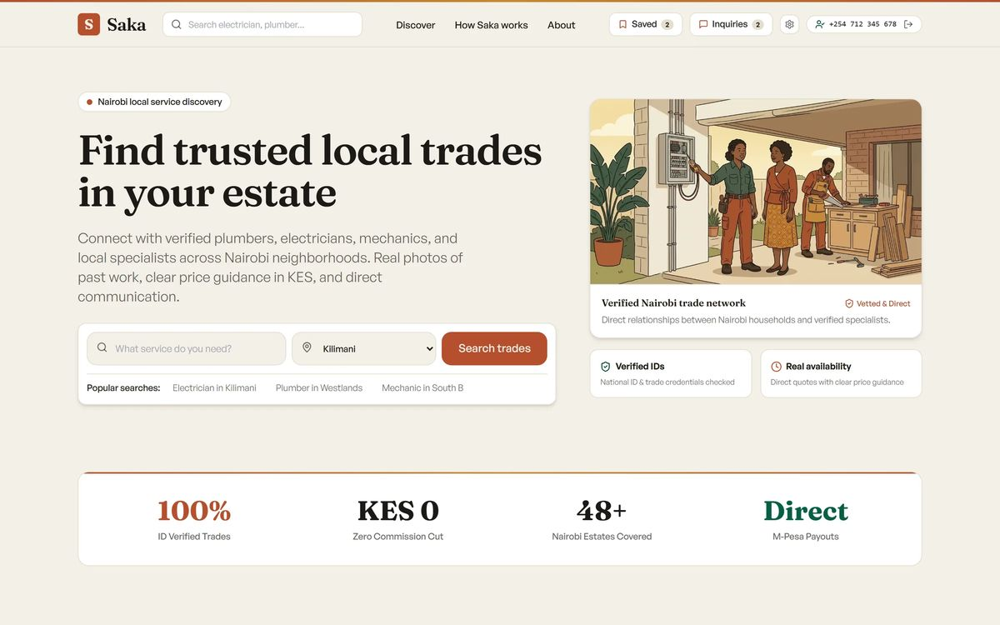</a>

### Saka
Product · Founder · Launching

Inquiry-first marketplace for finding verified tradespeople in Nairobi. Direct M-Pesa, no commission.

Next.js 14 · Supabase · Google Maps · Cloudinary 
[Live](https://sakahapa.vercel.app) · Private repo

<b>Case notes</b>

 

Finding a plumber, electrician or mechanic you can trust in Nairobi usually means asking around. On Saka you message a pro directly, agree on the job, and pay them straight through M-Pesa; Saka takes no commission. I'm the main founder and lead product in a team of five.

**Hardest part:** finding skilled tradespeople and checking them before they're approved, because the marketplace is only as good as the pros on it.

</td>
</tr>
<tr>
<td width="50%" valign="top">

<a href="https://dogear-nine.vercel.app">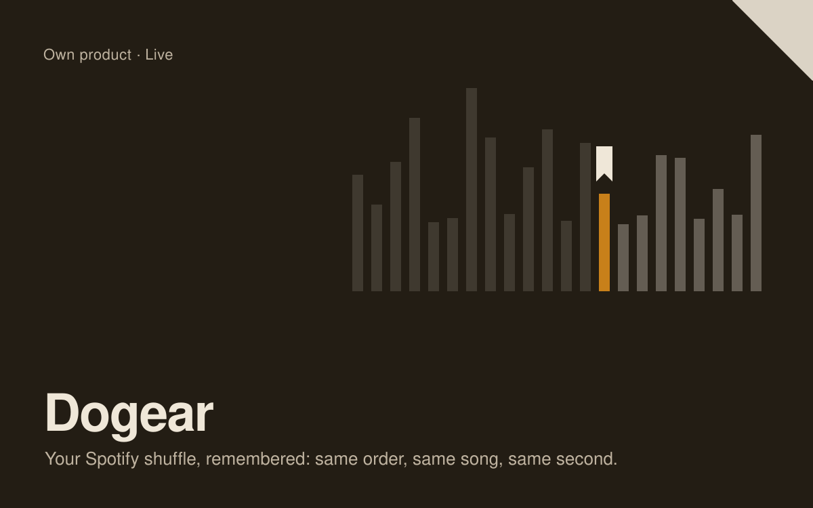</a>

### Dogear new
Own product · 2026

Spotify companion that keeps a fixed shuffle per playlist and resumes on the exact song and second.

Next.js · TypeScript · Supabase · Spotify Web API · Vercel 
[Live](https://dogear-nine.vercel.app) · Private repo

<b>Case notes</b>

 

Switch playlists on Spotify and your shuffle is gone when you come back. Dogear keeps a fixed, seeded shuffle for each playlist and a bookmark where you stopped, so **Resume** lands on the same song, at the same second.

- Shuffle that spreads artists out, so the same artist doesn't play twice in a row
- Background playback polling with skip detection
- Full listening history, past Spotify's 50-track limit
- Installable on Android

Runs in Spotify's development mode, so it's limited to a handful of invited users.

</td>
<td width="50%" valign="top">

<a href="https://gikuyu-translate.vercel.app">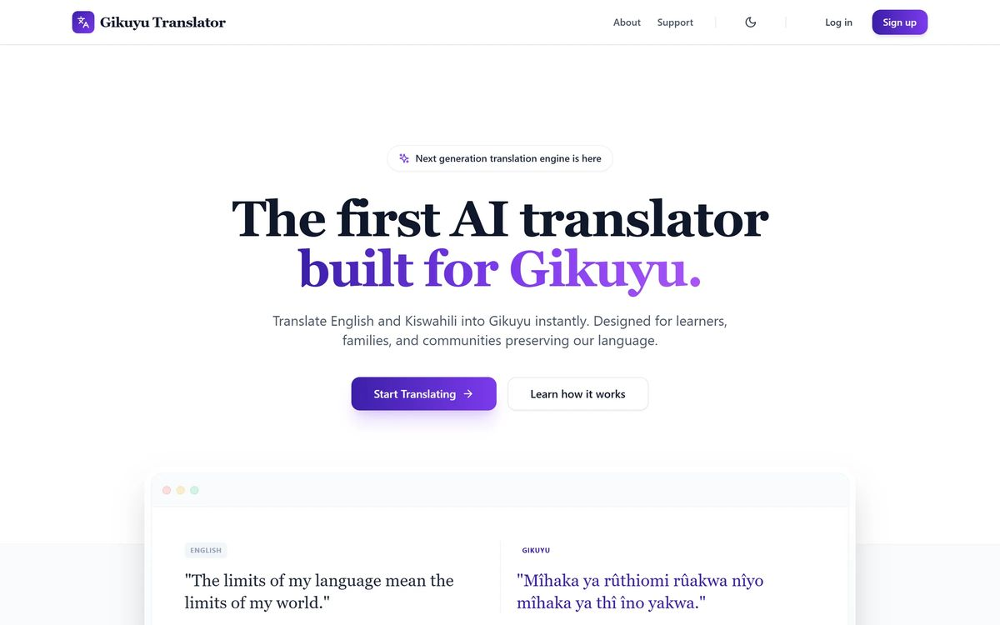</a>

### Gikuyu Translator
Experiment · 2026

AI translation from English and Kiswahili into Gikuyu, with spoken output.

Next.js · Gemini API · ElevenLabs API 
[Live](https://gikuyu-translate.vercel.app) · [Code](https://github.com/chillyreward/New-translator)

<b>Case notes</b>

 

Built for learners, families and communities keeping the language alive. Gemini handles translation, ElevenLabs reads the result aloud, and a phrasebook and history keep useful translations close. Now part of NeuroGrowth's product line.

**Hardest part:** finding an API that handles Gikuyu well enough to be useful.

</td>
</tr>
<tr>
<td width="50%" valign="top">

<a href="https://www.neurogrowthtech.com">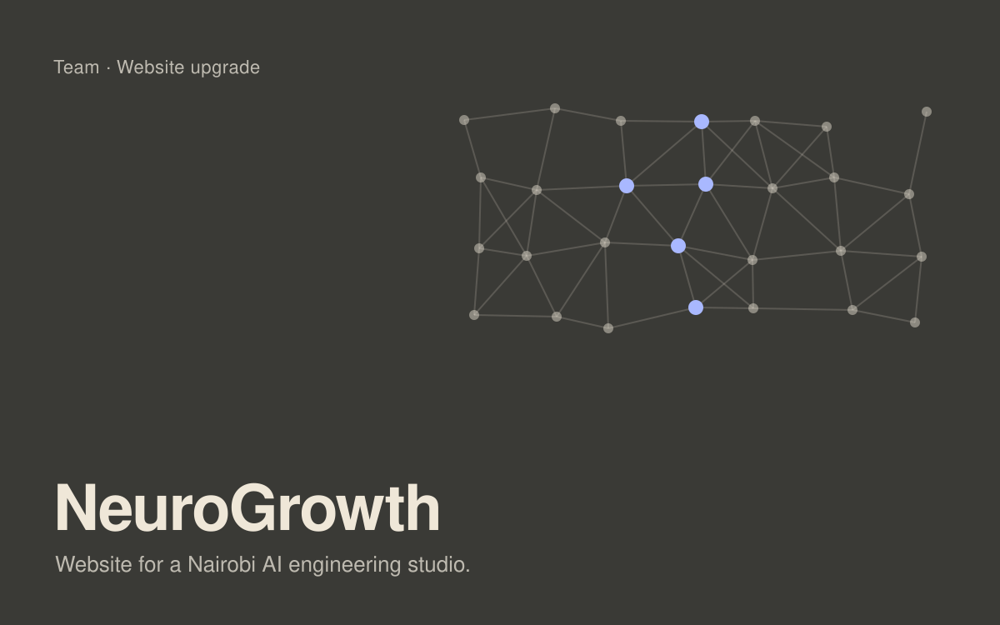</a>

### NeuroGrowth
Team · Marketing Engineering · 2026

Full website upgrade for a Nairobi AI engineering studio.

Next.js · TypeScript · Tailwind CSS 
[Live](https://www.neurogrowthtech.com) · [Code](https://github.com/Neuro-growth/neurogrowthwebsite)

<b>Case notes</b>

 

NeuroGrowth Tech builds automation, chatbots and prediction systems for African businesses. I'm on the team in Marketing Engineering and led the upgrade of the company website.

</td>
<td width="50%" valign="top">

<a href="https://oppoliakenya.co.ke">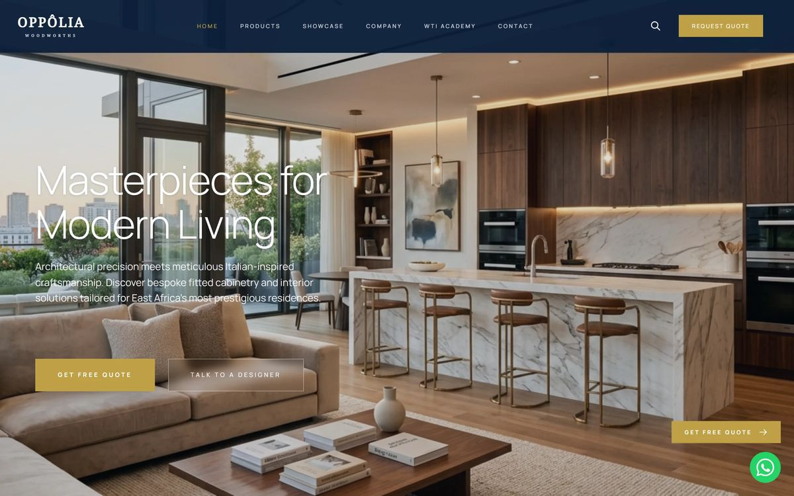</a>

### Oppolia Woodworths Kenya
Client · 2026

Showcase and quote-request site for a luxury fitted-cabinetry company.

Next.js · TypeScript · Tailwind CSS 
[Live](https://oppoliakenya.co.ke)

<b>Case notes</b>

 

A showcase for their kitchens and interior work, with clear ways to start a project: request a free quote, talk to a designer, or message the team on WhatsApp. I built it as the full-stack developer.

</td>
</tr>
</table>

<b>More work</b> · Sucre Bushworks, and this portfolio

 

<a href="https://sucre-bushworks.vercel.app">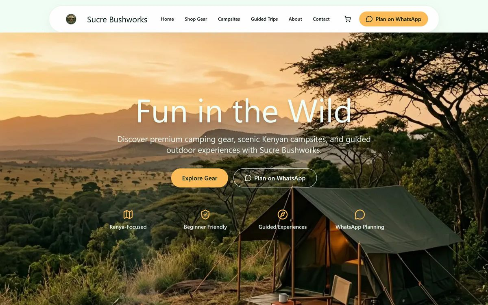</a>

**[Sucre Bushworks](https://sucre-bushworks.vercel.app)** · Client · Camping gear, Kenyan campsites and guided trips, with an inquiry basket sent over WhatsApp.

**[This portfolio](https://lennydev.vercel.app)** ([code](https://github.com/chillyreward/DunePortfolio)) · My site, built on an original design system inspired by Frank Herbert's *Dune*: sand by day, Giedi Prime by night.

## Being built

Client and family work in progress. The repositories are private, so they don't show on my profile; <a href="mailto:lennykidavik@gmail.com?subject=Walkthrough%20request">ask me for a walkthrough</a>.

<table>
<tr>
<td width="33%" valign="top">

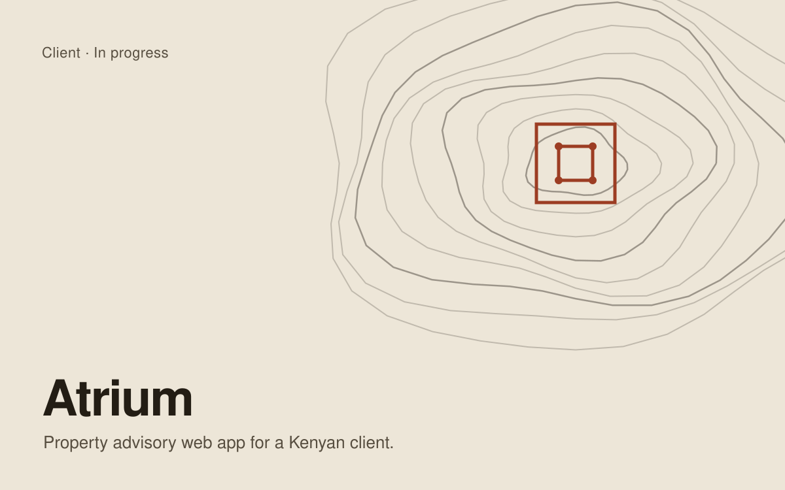

### Atrium
Client · In progress

Property advisory web app for a Kenyan client, priced in KES.

<b>Scope</b>

 

- Listings with filters, verification checks and payment-plan illustrations
- Admin with a leads pipeline and an AI lead qualifier
- Client portal: holdings, payment schedules and documents

Next.js 14 · TypeScript · Tailwind CSS · Supabase

</td>
<td width="33%" valign="top">

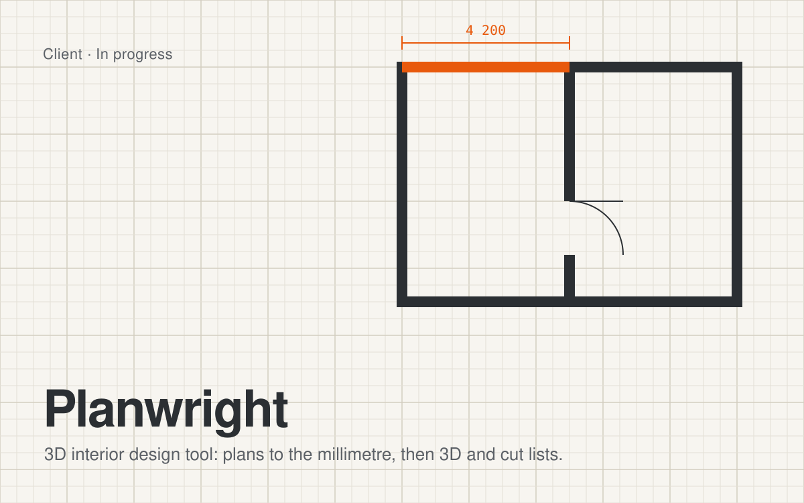

### Planwright
Client · In progress

Browser-based 3D interior design tool for interior designers.

<b>Scope</b>

 

- Precise 2D floor-plan editor, every value in millimetres
- 3D walkthrough generated from the same design document
- Parametric cabinets, drawings and cut lists; AI features in later phases

Next.js 14 · TypeScript · Supabase · later React Three Fiber

</td>
<td width="33%" valign="top">

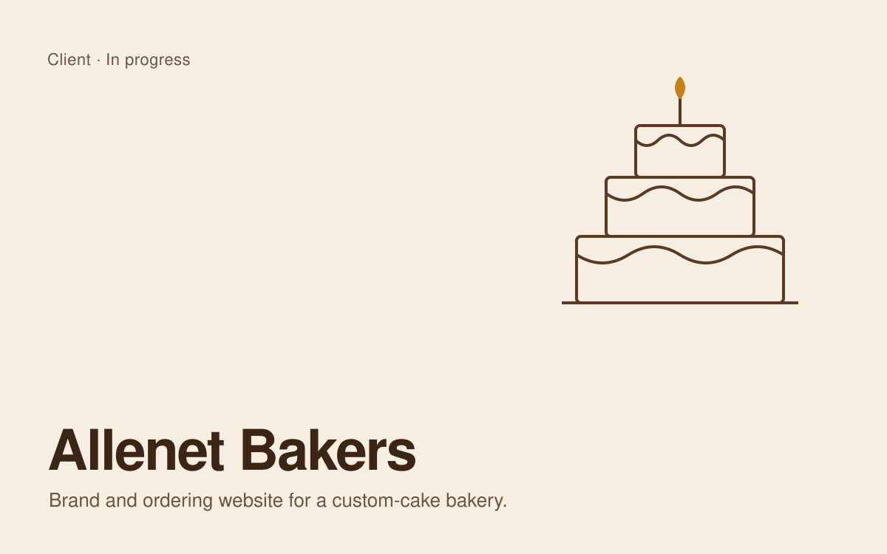

### Allenet Bakers
Client · In progress

Rebrand and ordering website for a custom-cake bakery in Ongata Rongai.

<b>Scope</b>

 

- New logo and brand system
- Website for celebration cakes and cupcakes, with an order flow
- Google Business Profile and Workspace on the new domain

</td>
</tr>
</table>

## Recognition

<!-- Newest first. Format: Result — Event, organiser · Month Year · Project -->

<table>
<tr>
<td width="45%" valign="top">
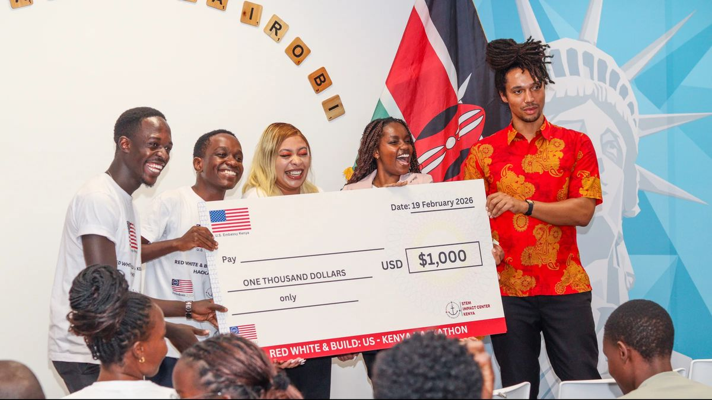
</td>
<td valign="top">

**1st place** — Red, White & Build US–Kenya Hackathon (AI & Tech) 
U.S. Embassy Kenya · Nairobi · 19 Feb 2026 · $1,000 prize

Won with **SmartChama**, with Rachael, Shilla and Nanjoli.

**2nd place** — Beorchild Hackathon 
Online · 2026

Second place, again with **SmartChama**.

</td>
</tr>
</table>

## Toolkit

**Ship with** &nbsp; TypeScript · Next.js · React · Tailwind CSS · Supabase · PostgreSQL · Zustand · TanStack Query · Vercel · Figma 
**Also used** &nbsp; Solidity · Firebase · Spotify Web API · Gemini API · Python · Java · C · Docker · Git 
**Learning** &nbsp; PyTorch · statistics and probability for ML

## Recent activity

<!--
  Filled in automatically every day by .github/workflows/recent-activity.yml.
  Only public repositories appear here; most client work is private.
  Do not edit between the two markers; the workflow overwrites it.
-->
<!--START_SECTION:activity-->
- [SmartChama](https://github.com/chillyreward/SmartChama) — SmartChama: A PWA digital ledger for Kenyan Chamas built with Next.js and Firebase. · updated 14 Oct 2026
- [SmartChama-Mobile](https://github.com/chillyreward/SmartChama-Mobile) · updated 14 Oct 2026
- [DunePortfolio](https://github.com/chillyreward/DunePortfolio) · updated 4 Oct 2026
- [New-translator](https://github.com/chillyreward/New-translator) · updated 29 Jun 2026
- [gikuyu-translate](https://github.com/chillyreward/gikuyu-translate) · updated 18 May 2026
<!--END_SECTION:activity-->

## Across the sand

<!--
  Drawn every day by .github/workflows/sandworm.yml from my contribution
  calendar (private contributions included if enabled on my profile),
  in a sand palette instead of GitHub's green. Lives on the `output` branch.
-->
<picture>
  <source media="(prefers-color-scheme: dark)" srcset="https://raw.githubusercontent.com/chillyreward/chillyreward/output/sandworm-dark.svg">
  
</picture>

 

<picture>
  <source media="(prefers-color-scheme: dark)" srcset="./assets/ridge-dark.svg">
  
</picture>

<i>Fear is the mind-killer.</i> — Frank Herbert, <i>Dune</i>

